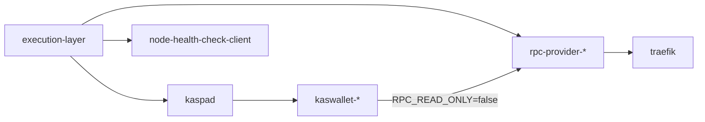

# Debug: Service Restarts And Dependency Exits

Use this guide when a service unexpectedly exits, keeps restarting, or appears to hang while waiting for another component.

## What Controls Restart Behavior

There are two layers involved:

1. `scripts/lib/watch-dependencies.sh`
   This wrapper waits for declared dependencies before starting the real process. While the process runs, a failed check is logged and retried; after `DEPENDENCY_FAILURE_THRESHOLD` (default 3) consecutive failed checks it stops the child and exits with status `1`. See [Dependency Watchdog](#dependency-watchdog).

2. Docker restart policy
   Most core services in `docker-compose.yml` use `SERVICE_RESTART_POLICY`.

Default behavior by environment:

- Mainnet: `SERVICE_RESTART_POLICY=unless-stopped`
- Galleon testnet: `SERVICE_RESTART_POLICY=unless-stopped`
- Dev: `SERVICE_RESTART_POLICY=no`
- Not set in `.env`: Compose falls back to `no`

A missing `SERVICE_RESTART_POLICY` line and an explicit `no` behave the same: after the watchdog stops a service, it stays down until someone starts it. Check what a node actually runs with:

```bash
docker inspect -f '{{.Name}} {{.HostConfig.RestartPolicy.Name}}' \
  kaspad execution-layer traefik $(docker ps -a --format '{{.Names}}' | grep -E '^(kaswallet|rpc-provider)-')
```

Two services currently pin `restart: unless-stopped` directly in Compose:

- `node-health-check-client`
- `atan-uploader`

## Dependency Map



## Restart Frontend Without Touching Backend

`frontend-w*` profiles do not need to activate backend services directly. For a full stack start, bring up both profiles:

```bash
docker compose --profile backend --profile frontend-w5 up -d --no-build
```

If backend is already running and you only want to bounce frontend services, restart the frontend profile directly:

```bash
docker compose --profile frontend-w5 restart
```

To remove and recreate frontend containers without touching backend:

```bash
docker compose --profile frontend-w5 down
docker compose --profile frontend-w5 up -d --no-build
```

For fewer workers, replace `frontend-w5` with `frontend-w1` through `frontend-w4`.

This works because `kaspad` and `execution-layer` are not part of the `frontend-w*` profile set, so profile-scoped `restart` and `down` only target frontend services.

## Quick Triage

### 1. Check current container state

```bash
docker compose ps
```

This tells you whether the container is currently `Up`, `Exited`, or flapping.

### 2. Check whether Docker actually restarted it

```bash
docker inspect -f 'name={{.Name}} restart_count={{.RestartCount}} status={{.State.Status}} exit_code={{.State.ExitCode}} started={{.State.StartedAt}} finished={{.State.FinishedAt}} error={{.State.Error}}' rpc-provider-0
```

Interpretation:

- `restart_count=0` with `status=running`: the container has not restarted yet
- `restart_count=0` with `status=exited`: it exited and stayed down
- `restart_count>0`: Docker restarted the same container at least once

### 3. Read recent logs with timestamps

```bash
docker compose logs --timestamps --since 30m rpc-provider-0
docker compose logs --timestamps --since 30m kaspad
docker compose logs --timestamps --since 30m traefik
```

Use `-f` if you want to keep watching:

```bash
docker compose logs --timestamps --since 10m -f rpc-provider-0 traefik
```

### 4. Check Docker restart events

```bash
docker events --since 30m --filter container=rpc-provider-0
```

This helps confirm whether Docker restarted the container or whether it simply stayed up and kept polling for dependencies.

## Dependency Watchdog

### What a check is

- `--tcp` opens a TCP connection to the host and port, then closes it. It does not send JSON-RPC, and it does not touch the Engine API (port 8551). A passing check only means the port accepted a connection.
- `--http` and `--http-any` request the URL with `wget --spider` and pass on a successful response.
- A check round tests every declared dependency in order. The round fails at the first dependency that fails.

### When the child is stopped

- Before the child starts, the wrapper waits as long as it takes for one fully successful round.
- Once the child runs, a failed round is logged and retried. After `DEPENDENCY_FAILURE_THRESHOLD` consecutive failed rounds the wrapper sends the child `SIGTERM`, waits for it to exit, and exits with status `1`.
- One fully successful round resets the count. Failures of different dependencies in consecutive rounds still count together.
- `DEPENDENCY_FAILURE_THRESHOLD=1` restores the old behaviour of stopping on the first failed check.

Why the threshold exists: on a loaded node, a single probe once overran its 2 s deadline while the dependency kept running, and stopping on the first failure turned that into a restart cascade (kaspad needs about 90 s to shut down, and every kaswallet followed it). What delayed that probe (CPU scheduling, memory paging, I/O or the network) was never established.

The default of 3 matches the Compose healthchecks' `retries: 3`. It tolerates up to two failed rounds followed by a success, while a dependency that stays down still stops the service. It is a provisional value: confirm it during staged validation before relying on it.

### Settings

Set these in `.env`. Compose passes them to kaspad, every kaswallet and rpc-provider, and traefik. They take effect when the containers are recreated (see [Rolling Out Watchdog Changes](#rolling-out-watchdog-changes)). Values are whole numbers; an invalid value falls back to the default and is reported once at startup. The devnet compose file does not pass them through, so devnet always uses the defaults.

| Variable | Default | Meaning |
|---|---|---|
| `DEPENDENCY_CHECK_INTERVAL_SECONDS` | 5 | Pause after each check round |
| `DEPENDENCY_TCP_TIMEOUT_SECONDS` | 2 | Deadline for one TCP connect |
| `DEPENDENCY_HTTP_TIMEOUT_SECONDS` | 2 | `wget` timeout for one HTTP request |
| `DEPENDENCY_FAILURE_THRESHOLD` | 3 | Consecutive failed rounds before the child is stopped |

### How long until a stop

The interval is a pause after each round, not a fixed schedule. With the defaults and one TCP dependency:

- A refused connection fails at once, so the third failed round comes about 10 s after the first.
- A connection that never completes uses its full 2 s deadline each round, so the stop comes about 16 s after the first failed round starts.
- Host scheduling delays add to both.

For traefik's `--http-any`, a round where every backend hangs costs about `configured workers × DEPENDENCY_HTTP_TIMEOUT_SECONDS`. Backends that are not configured fail fast on name resolution.

### Log lines

| Line | Meaning |
|---|---|
| `watching dependencies for <command>: check every 5s, ...` | Effective settings, printed once at start |
| `<reason>; waiting before starting <command>` | The child has not started; logged at the first failure and whenever the reason changes |
| `still waiting: <reason> (N failed checks)` | Reminder every 60 failed checks while waiting to start |
| `dependencies ready; starting <command>` | Startup gating passed |
| `<reason>; check 1/3 failed, retrying` | First failure of a streak while the child runs; repeats of the same reason are not logged |
| `<reason>; check 2/3 failed, retrying` | A later failure in the same streak whose reason differs from the previous one |
| `dependencies ready again after N failed check(s)` | The streak ended without a stop |
| `<reason>; check 3/3 failed, stopping <command>` | The wrapper stopped the child |

Runtime failure lines end with `host pressure avg10: cpu=... memory=... io=...` where the kernel exposes `/proc/pressure`.

### Failure reasons

A reason looks like `execution-layer is unavailable at execution-layer:8545 (tcp connect refused)`.

| Reason | Meaning |
|---|---|
| `tcp connect refused` | Nothing listens on the port, for example the service is restarting |
| `name resolution failed` | The name does not resolve, for example the container is stopped or removed |
| `no tcp connect within Ns` | No connection before the deadline. Either the dependency did not answer, or the probe itself could not run in time on a loaded host; check the `host pressure` values on the same line |
| `took Xms against a Ns deadline, watcher was delayed` | Appended when a probe ended long after its deadline. The probe is killed at the deadline, so the watcher or the probe was not scheduled on time: suspect host CPU, memory or I/O pressure rather than the dependency |
| `http connect refused`, `http request timed out`, `http error HTTP/1.1 503 ...` | BusyBox `wget` (traefik) results |
| `wget exit N` | GNU `wget` prints nothing with `--quiet`; only its exit status is known |

Limitations: a name lookup that hangs, a TCP connect that hangs, and a probe starved of CPU before it connects all end as `no tcp connect within Ns`. The `watcher was delayed` note only appears when the check overruns its deadline by more than 500 ms, so its absence does not rule out host pressure.

## How To Tell What Happened

### Service is waiting for a dependency

Typical signals:

- `docker compose ps` shows the container as `Up`
- `restart_count=0`
- logs show `[watch-dependencies] ... waiting before starting ...`, then `still waiting: ...` reminders
- logs do not show `dependencies ready; starting ...` yet

This means the wrapper is still running and the child command has not started.

### Service exited and stayed down

Typical signals:

- `docker compose ps` shows `Exited`
- `restart_count=0`
- logs end with `[watch-dependencies] ... check 3/3 failed, stopping ...`

This is expected when the restart policy is `no` or `SERVICE_RESTART_POLICY` is missing from `.env`.

### Service restarted after an error

Typical signals:

- `restart_count>0`
- logs contain an earlier failure, then a fresh startup sequence later
- `docker events` shows restart-related lifecycle events

This is expected on mainnet for services using `SERVICE_RESTART_POLICY=unless-stopped`.

## Are Logs Persistent After Restart

Yes, in the current default setup they are.

The environment examples set:

```bash
LOGGING_DRIVER=json-file
```

With the `json-file` driver:

- `docker logs` and `docker compose logs` continue to show earlier log lines after a restart of the same container
- the log stream is appended across restarts of that container
- log rotation still applies because Compose sets `max-size`, `max-file`, and `compress`

Important distinction:

- Restarted container: same container, logs remain visible via `docker logs`
- Recreated container: new container ID, old logs stay attached to the old container until it is removed

To compare container identity:

```bash
docker inspect -f 'id={{.Id}} created={{.Created}} started={{.State.StartedAt}}' rpc-provider-0
```

If you switch to `LOGGING_DRIVER=syslog`, persistence depends on the host logging system instead of Docker's `json-file` storage.

## Common Signatures

### `[watch-dependencies] execution-layer is unavailable at execution-layer:8545 (...)`

Meaning:

- a TCP connect to the execution layer failed; the reason in brackets says how (see [Failure reasons](#failure-reasons))
- `check 1/3 failed, retrying`: the service keeps running; a following `dependencies ready again` line means it recovered

What to check:

```bash
docker compose ps
docker compose logs --timestamps --since 15m execution-layer
docker inspect -f 'restart_count={{.RestartCount}} status={{.State.Status}}' execution-layer
```

### `[watch-dependencies] rpc-backends has no healthy endpoints (20 checked, first ...)`

Meaning:

- none of the RPC health URLs responded successfully; the line names the first URL and why it failed

What to check:

```bash
docker compose ps
docker compose logs --timestamps --since 15m rpc-provider-0 rpc-provider-1 traefik
```

Note:

- `traefik` uses `--http-any`, so only one healthy RPC backend is required
- if you run `watch-dependencies.sh` manually from the host shell, Docker-internal names like `rpc-provider-0` only work if they resolve from your current network context

### `[watch-dependencies] missing command`

Meaning:

- the wrapper was invoked directly without `-- command ...`

Correct pattern:

```bash
./scripts/lib/watch-dependencies.sh -- /bin/true
```

### `[watch-dependencies] ignoring invalid <setting>=<value>; using N`

Meaning:

- a setting is not a positive whole number, so the default applies. `<setting>` is the variable name, or `check interval` for `DEPENDENCY_CHECK_INTERVAL_SECONDS` and `--interval`

## Rolling Out Watchdog Changes

Changing the watchdog settings, or the Compose file that passes them, recreates kaspad, every kaswallet and rpc-provider, and traefik. Docker's default stop timeout is 10 s, and kaspad can need about 90 s to shut down cleanly, so give it time:

```bash
# N is the node's worker count, the same frontend-wN profile the node already runs.
docker compose --profile backend --profile frontend-w<N> up -d --no-build --timeout 120
```

Stage the rollout:

1. CI: `scripts/ci/test-watch-dependencies.sh` and the Compose checks pass.
2. One node first. Read back the effective settings (`docker logs kaspad 2>&1 | grep 'watching dependencies'`) and the restart policy (command above). Then watch the `check k/3 failed, retrying`, `ready again` and `stopping` lines, `RestartCount`, and host pressure for an agreed period.
3. Expand to the remaining nodes only if no unexpected stops occurred.

Roll back by setting `DEPENDENCY_FAILURE_THRESHOLD=1` in `.env` and recreating the containers with the same `docker compose --profile backend --profile frontend-w<N> up -d --no-build --timeout 120`, which restores stop-on-first-failure. To return to the previous script entirely, revert the change and recreate.

To check process cleanup with the wrapper as PID 1, as in the containers, run it locally, never on a live node:

```bash
docker run -d --name watch-pid1 \
  -v "$PWD/scripts/lib/watch-dependencies.sh:/app/watch-dependencies.sh:ro" \
  debian:bookworm-slim sh /app/watch-dependencies.sh --tcp dep 127.0.0.1 1 -- sleep infinity
sleep 30; docker top watch-pid1   # only the wrapper (PID 1) and at most one probe or sleep
docker stop watch-pid1            # returns at once
docker inspect -f '{{.State.ExitCode}}' watch-pid1   # 143
docker rm watch-pid1
```

## Recommended Debug Flow

When a service looks unhealthy:

1. Run `docker compose ps`
2. Inspect `RestartCount` and state timestamps
3. Read recent logs with `--timestamps --since ...`
4. Check the upstream service named in the `watch-dependencies` message
5. Use `docker events` if you need to confirm actual restart behavior

For example, if `rpc-provider-0` is failing:

```bash
docker compose ps
docker inspect -f 'restart_count={{.RestartCount}} status={{.State.Status}} started={{.State.StartedAt}} finished={{.State.FinishedAt}}' rpc-provider-0
docker compose logs --timestamps --since 15m rpc-provider-0 execution-layer kaswallet-0
docker events --since 15m --filter container=rpc-provider-0
```

## Related Docs

- [Log Management](../log-management.md)
- [Mainnet Deployment Guide](../quick-setup-mainnet.md)
- [Galleon Testnet Deployment Guide](../quick-setup-galleon-testnet.md)
